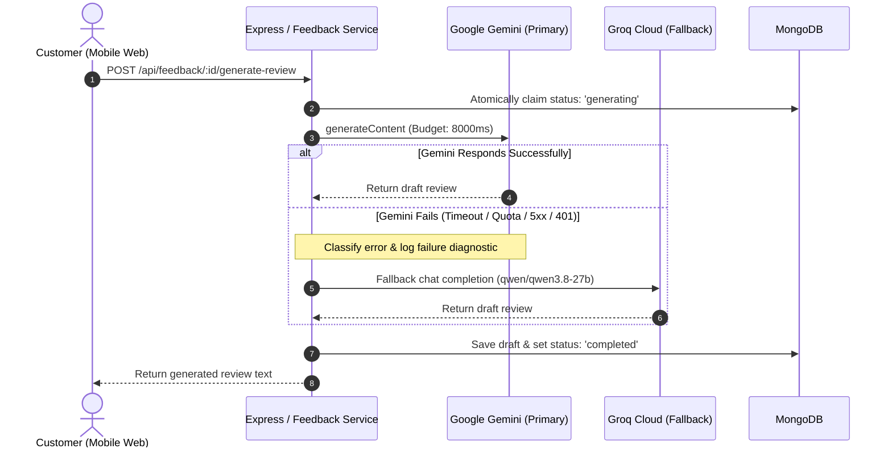

# Smart AI Google Review Builder

A production-ready, mobile-first Google Review acceleration web application engineered for **Dula Mobiles** in **Anuppur, Madhya Pradesh**. The system transforms in-store customer feedback into authentic, high-converting Google review drafts using a dual-provider AI pipeline (**Google Gemini** primary with automatic **Groq** fallback).

---

## Table of Contents

- [Overview](#overview)
- [Key Features](#key-features)
- [Technology Stack](#technology-stack)
- [System Architecture](#system-architecture)
  - [Architecture Flow Diagram](#architecture-flow-diagram)
  - [Feedback Persistence & Concurrency](#feedback-persistence--concurrency)
  - [Multi-Provider AI Fallback Engine](#multi-provider-ai-fallback-engine)
- [Project Directory Structure](#project-directory-structure)
- [Prerequisites](#prerequisites)
- [Installation and Setup](#installation-and-setup)
- [Environment Configuration](#environment-configuration)
- [Running Locally](#running-locally)
- [API Reference](#api-reference)
  - [GET /api/health](#get-apihealth)
  - [GET /api/config](#get-apiconfig)
  - [POST /api/feedback](#post-apifeedback)
  - [POST /api/feedback/:id/generate-review](#post-apifeedbackidgenerate-review)
- [AI Fallback Engine Details](#ai-fallback-engine-details)
- [Google Review & QR Code System](#google-review--qr-code-system)
- [Testing Suite](#testing-suite)
  - [Automated Unit & Integration Tests (Mocked)](#automated-unit--integration-tests-mocked)
  - [Live Provider Smoke Tests (Requires API Keys)](#live-provider-smoke-tests-requires-api-keys)
- [Security, Privacy & Data Integrity](#security-privacy--data-integrity)
- [Troubleshooting](#troubleshooting)
- [Deployment Guidelines](#deployment-guidelines)
- [Limitations & Future Roadmap](#limitations--future-roadmap)
- [License](#license)

---

## Overview

Local retail customers frequently intend to leave positive Google reviews after a satisfying store visit, but abandon the process when confronted with a blank text box ("writer's block") or unfamiliarity with composing English reviews.

**Smart AI Google Review Builder** bridges this gap for **Dula Mobiles**:
1. **Frictionless QR/NFC Access:** Customers scan an in-store counter standee QR code or tap an NFC tag to open the mobile-optimized web app.
2. **Local Hinglish Questionnaire:** Customers select an intuitive 1–5 star rating and choose one or more quick, familiar Hinglish service tags representing Dula Mobiles' core offerings (mobile phone pricing, accessories variety, and hardware repair).
3. **AI Review Synthesis:** The backend prompts a high-speed LLM to draft an authentic, first-person 2–4 sentence review reflecting the customer's exact inputs.
4. **Resilient Dual-AI Architecture:** The system attempts Google Gemini first; if Gemini is rate-limited, times out, experiences quota exhaustion, or fails, it instantaneously falls back to Groq without impacting the customer.
5. **1-Click Copy & Google Redirection:** The customer reviews their draft, makes any optional edits, and taps **"Post a Review on Google"**. The complete draft is copied to their mobile clipboard while opening Dula Mobiles' official Google Business Profile review dialog in a new tab.

---

## Key Features

- **Mobile-First In-Store Interface:** Responsive viewport styling with circular branded avatar, star rating selector, category blocks, character counters, and animated loading states.
- **Categorized Hinglish Feedback Options:** 12 localized Hinglish tags tailored to the mobile store's offerings in Anuppur:
  - 📱 **Mobile Phones:** *Online se bhi kam rate mein phone mile*, *Achhi quality ke saath sabhi tarah ke phones available hain*, *Anuppur ki best mobile shop*, *Anuppur mein sabse kam rate par phones milte hain*.
  - 🎧 **Mobile Accessories:** *Original mobile accessories milte hain*, *Premium quality ke phone covers milte hain*, *Phone covers reasonable rate mein milte hain*, *Anuppur mein mobile accessories ki best variety hai*.
  - 🔧 **Mobile Repairing:** *Kam rate mein achhi mobile repairing hoti hai*, *Original parts available hain*, *Anuppur mein original mobile displays milte hain*, *Anuppur mein fast mobile repairing service milti hai*.
  - *Full backward compatibility for legacy English options (e.g., "Friendly staff", "Good service").*
- **Two-Phase Decoupled Persistence:** Customer feedback is safely saved to MongoDB **before** invoking AI review generation. Generation failures never cause submitted ratings or comments to be lost.
- **Editable AI Review Drafts:** Customers retain full editorial freedom. They can modify, expand, or rewrite generated drafts before posting.
- **Robust Multi-Tier Clipboard Copying:**
  - Modern `navigator.clipboard.writeText` API in secure/localhost contexts.
  - Active `<textarea>` programmatic selection with `document.execCommand('copy')`.
  - Hidden offscreen `<textarea>` fallback for older mobile browsers.
  - Manual copy fallback banner ensuring drafts are highlighted if system clipboard permissions are denied.
  - **Zero Truncation Guarantee:** No arbitrary word limits; full reviews of any length are preserved.
- **Dynamic Google-Themed QR Code SVG:**
  - Generated dynamically via Error Correction Level `H` (30% error recovery).
  - Employs Google's signature 4-color palette (`#4285F4`, `#EA4335`, `#FBBC05`, `#34A853`), dark high-contrast modules (`#111827`), and a centered circular shield embedding the official Google "G" vector mark.
  - Fully verified as 100% scannable via `jsQR`.
- **Standee QR Modal:** Staff can open the in-app QR modal to display the scannable code directly on tablets or counter screens, or copy the direct feedback link.
- **Rate-Limiting & Security Protection:** General API endpoints are protected at 100 requests / 15 minutes; AI generation is throttled at 20 requests / 15 minutes per IP.

---

## Technology Stack

### Frontend Client
| Technology | Version / Specification | Role |
| :--- | :--- | :--- |
| **HTML5 & CSS3** | Modern semantic standards | Mobile-first layout, custom properties, responsive UI |
| **Vanilla JavaScript** | ES Modules (`type: "module"`) | State management, asynchronous API calls, clipboard handling |
| **QRCode (Client Vendor)** | `^1.5.4` | In-browser QR matrix calculation with Level-H error correction |
| **Dev Server / Proxy** | Node.js HTTP Server (`dev-server.js`) | Local static file serving & reverse proxy (`http://localhost:5173`) |

### Backend Server
| Technology | Version / Specification | Role |
| :--- | :--- | :--- |
| **Node.js** | `>= 20.0.0` (ESM) | Server runtime |
| **Express** | `^5.1.0` | HTTP routing, middleware pipeline, static SPA fallback |
| **Mongoose** | `^8.13.2` | MongoDB ODM, validation schemas, atomic transitions |
| **MongoDB** | `>= 6.0` | Feedback persistence & generation status tracking |
| **Zod** | `^3.24.2` | Strict runtime request validation (body, params) |
| **@google/genai** | `^1.30.0` | Official Google Gen AI SDK for Gemini models |
| **groq-sdk** | `^1.6.0` | Groq official SDK for high-speed fallback generation |
| **Helmet** | `^8.0.0` | HTTP security headers |
| **CORS** | `^2.8.5` | Cross-origin resource sharing policy enforcement |
| **express-rate-limit** | `^7.5.0` | IP-based request throttling and abuse prevention |
| **dotenv** | `^16.4.7` | Environment variable loader |

### Testing & Development
| Technology | Version / Specification | Role |
| :--- | :--- | :--- |
| **node:test & node:assert** | Node.js native test runner | Concurrency-safe backend and client unit/integration tests |
| **jsQR** | `^1.4.0` | Validates generated QR SVG images against raw pixel decoders |
| **nodemon** | `^3.1.9` | Development hot-reloading for server scripts |

---

## System Architecture

### Architecture Flow Diagram

```mermaid
flowchart TD
    subgraph Client ["Client Browser / Mobile PWA (Port 5173 or 5000)"]
        UI["Customer UI<br/>(Star Rating + Hinglish Chips + Comment)"]
        QR["Standee QR Modal<br/>(Google-Themed SVG, Level H)"]
        CopyEngine["Clipboard Manager<br/>(navigator.clipboard / execCommand)"]
    end

    subgraph Server ["Express 5.1.0 Backend API (Port 5000)"]
        Proxy["Dev Reverse Proxy / CORS & Helmet"]
        RateLimiter["Rate Limiters<br/>(100/15min API, 20/15min AI)"]
        ZodVal["Zod Validators<br/>(Strict payload validation)"]
        Controller["Feedback Controller<br/>(asyncHandler & safe errors)"]
        FeedbackSvc["Feedback Service<br/>(Atomic MongoDB state machine)"]
        AIOrchestrator["AI Provider Orchestrator<br/>(Timeout budget, Error classifier)"]
    end

    subgraph Database ["Persistence Layer"]
        Mongo[("MongoDB Database<br/>'Feedback' Collection")]
    end

    subgraph AIProviders ["AI Provider Network"]
        Gemini["Google Gemini<br/>(Primary: gemini-3.1-flash-lite)"]
        Groq["Groq Cloud<br/>(Fallback: qwen/qwen3.8-27b)"]
    end

    subgraph GoogleEcosystem ["External Destination"]
        GoogleMaps["Google Business Profile<br/>Review Write Page"]
    end

    UI -->|1. POST /api/feedback| Proxy
    Proxy --> RateLimiter --> ZodVal --> Controller --> FeedbackSvc
    FeedbackSvc -->|Save original feedback (status: idle)| Mongo

    UI -->|2. POST /api/feedback/:id/generate-review| Proxy
    Controller --> FeedbackSvc
    FeedbackSvc -->|Atomic claim (status: generating)| Mongo
    FeedbackSvc --> AIOrchestrator

    AIOrchestrator -->|Primary attempt (8s timeout)| Gemini
    Gemini -.->|Fail / Timeout / Quota Exhaustion| AIOrchestrator
    AIOrchestrator -->|Automatic fallback attempt| Groq
    Gemini -->|Success| FeedbackSvc
    Groq -->|Success| FeedbackSvc

    FeedbackSvc -->|Save review (status: completed)| Mongo
    FeedbackSvc -->|Return draft & googleReviewUrl| UI

    UI -->|3. 'Post a Review on Google'| CopyEngine
    CopyEngine -->|Copies full draft to clipboard| CopyEngine
    CopyEngine -->|Direct redirect / window.open| GoogleMaps
```

### Feedback Persistence & Concurrency

1. **Step 1: Feedback Capture (`POST /api/feedback`)**
   - The customer selects their rating (1–5), optional Hinglish chips, and optional comment.
   - The server validates input strictly via Zod and creates a MongoDB document with `generationStatus: "idle"`.
   - Returns HTTP `201 Created` with the persistent document `id`.

2. **Step 2: Generation Request (`POST /api/feedback/:id/generate-review`)**
   - **Idempotency:** If `regenerate: false` and a review already exists with status `completed`, the cached review is returned immediately.
   - **Atomic State Claiming:** Uses `Feedback.findOneAndUpdate` matching `{ _id: id, generationStatus: { $in: ['idle', 'failed'] } }` to set `generationStatus: "generating"`.
   - If two requests hit the endpoint simultaneously, one claims the generation lock while the other receives an HTTP `409 Conflict` (`GENERATION_IN_PROGRESS`) or the newly created draft.
   - If generation encounters an unrecoverable failure across all providers, the record is safely transitioned to `generationStatus: "failed"`. The customer's original rating, selected options, and comment remain intact.

### Multi-Provider AI Fallback Engine

- **Chain of Responsibility:** Configured via `AI_PROVIDER_ORDER=gemini,groq`.
- **Isolated Credentials:** API keys are never exposed in responses or client code. Placeholder keys are automatically detected and skipped without making superfluous network calls.
- **Error Normalization:** Provider exceptions are sanitized and categorized into standardized internal types (`AI_QUOTA_EXHAUSTED`, `AI_RATE_LIMIT`, `AI_AUTH_FAILURE`, `AI_UNSUPPORTED_MODEL`, `AI_TIMEOUT`, `AI_TEMPORARY_FAILURE`, `AI_EMPTY_RESPONSE`).
- **Root-Cause Preservation:** If both providers fail, the composite error retains the primary provider's initial failure category (e.g., quota exhaustion) so administrative logs diagnose root causes accurately rather than downstream fallback noise.

---

## Project Directory Structure

```text
AI Review System/
├── package.json                         # Root package workspace scripts (dev, start, test)
├── .gitignore                           # Git ignore rules (node_modules, .env, OS files)
│
├── client/                              # Frontend client application
│   ├── index.html                       # Responsive single-page interface
│   ├── app.js                           # Frontend controller, state, API calls, clipboard logic
│   ├── style.css                        # Mobile-first CSS styles, Google styling, animations
│   ├── dev-server.js                    # Node.js dev server with /api reverse proxy (port 5173)
│   ├── qr-generator.js                  # Level-H Google-themed dynamic QR SVG generator
│   ├── package.json                     # Client dependencies (qrcode, jsqr, esbuild)
│   ├── assets/
│   │   └── dulamobiles.jpeg             # Dula Mobiles branding logo asset
│   ├── vendor/
│   │   └── qrcode.js                    # Bundled browser-compatible QRCode generator
│   └── tests/
│       ├── frontend-transition.test.js  # DOM transition, clipboard copy, and wording tests
│       └── qr-scannable.test.js         # jsQR scanning verification and Google palette tests
│
└── server/                              # Backend Express application
    ├── server.js                        # Server entry point (starts DB connection & HTTP listener)
    ├── package.json                     # Server dependencies (@google/genai, groq-sdk, mongoose, etc.)
    ├── .env.example                     # Environment template with safe placeholders
    ├── scripts/
    │   ├── live-gemini-smoke.js         # End-to-end live Gemini API verification script
    │   └── live-fallback-smoke.js       # Live multi-provider fallback verification script
    ├── src/
    │   ├── app.js                       # Express application configuration, rate limiters, static serving
    │   ├── config/
    │   │   ├── db.js                    # Mongoose database connection helper
    │   │   └── index.js                 # Environment validation, provider configuration, sanitization
    │   ├── constants/
    │   │   └── feedbackOptions.js       # Categorized Hinglish options & legacy options whitelist
    │   ├── controllers/
    │   │   ├── errorController.js       # Centralized error handler (sanitizes 500 responses)
    │   │   └── feedbackController.js    # Feedback submission & review generation controller
    │   ├── middleware/
    │   │   └── validate.js              # Zod validation middleware wrapper
    │   ├── models/
    │   │   └── Feedback.js              # Mongoose Feedback schema & document model
    │   ├── routes/
    │   │   ├── configRoutes.js          # GET /api/config route definition
    │   │   ├── feedbackRoutes.js        # POST /api/feedback & review generation routes
    │   │   └── healthRoutes.js          # GET /api/health route definition
    │   ├── services/
    │   │   ├── aiProviderService.js     # Unified AI orchestrator (Gemini -> Groq fallback)
    │   │   ├── feedbackService.js       # Business logic for feedback & state transitions
    │   │   └── geminiService.js         # Primary Gemini service wrapper & model verification
    │   ├── utils/
    │   │   └── asyncHandler.js          # Async error wrapper for Express routes
    │   └── validators/
    │       └── feedbackValidator.js     # Strict Zod schemas for request payloads & parameters
    └── tests/
        ├── helpers/
        │   └── testApp.js               # Ephemeral in-memory test server & HTTP client helper
        ├── aiFallback.test.js           # Comprehensive Gemini-to-Groq fallback & error test suite
        └── feedback.test.js             # API validation, persistence, and Hinglish review test suite
```

---

## Prerequisites

- **Node.js:** `v20.0.0` or higher (`node -v`).
- **NPM:** `v10.0.0` or higher (`npm -v`).
- **MongoDB:** A locally running MongoDB instance (`mongodb://127.0.0.1:27017`) or a remote MongoDB Atlas connection URI.
- **AI Credentials (Optional for local testing, required for live AI generation):**
  - **Google Gemini API Key:** Obtainable from [Google AI Studio](https://aistudio.google.com/).
  - **Groq API Key:** Obtainable from [Groq Cloud Console](https://console.groq.com/).

---

## Installation and Setup

### 1. Clone & Enter the Repository
```powershell
git clone <repository-url>
cd "AI Review System"
```

### 2. Install Root, Server, and Client Dependencies
The root project delegates to the client and server packages. Install dependencies for both:

```powershell
# Install server dependencies
npm install --prefix server

# Install client dependencies
npm install --prefix client
```

---

## Environment Configuration

Copy the example environment template in the `server/` directory to create `.env`:

```powershell
Copy-Item server/.env.example server/.env
```

### Environment Variables Reference

| Variable | Required | Default / Placeholder | Description |
| :--- | :---: | :--- | :--- |
| `NODE_ENV` | Optional | `development` | Runtime environment (`development`, `production`, `test`). |
| `PORT` | Optional | `5000` | Port for the Express backend server. |
| `MONGO_URI` | **Yes** | `mongodb://127.0.0.1:27017/ai-review-system` | MongoDB connection string. Server will not boot without it. |
| `CLIENT_URL` | Optional | `http://localhost:5173` | Allowed CORS origin for frontend requests. |
| `PUBLIC_FEEDBACK_URL` | Optional | `http://localhost:5173` | Customer-facing URL encoded into the in-store standee QR code. |
| `BUSINESS_NAME` | Optional | `Dula mobiles` | Store name served via `/api/config` and injected into AI prompts. |
| `BUSINESS_LOCATION` | Optional | `Anuppur, Madhya Pradesh` | Store locality badge displayed in the client header. |
| `BUSINESS_LOGO_URL` | Optional | `/assets/dulamobiles.jpeg` | Relative or absolute path to the store's avatar image. |
| `GOOGLE_REVIEW_URL` | Optional | `https://search.google.com/local/writereview?placeid=YOUR_PLACE_ID` | Direct Google Business Profile review write page opened when customers post reviews. |
| `AI_PRIMARY_PROVIDER` | Optional | `gemini` | Primary AI provider to attempt (`gemini` or `groq`). |
| `AI_PROVIDER_ORDER` | Optional | `gemini,groq` | Comma-delimited failover execution order. |
| `GEMINI_API_KEY` | Optional* | `your_gemini_api_key_here` | Google Gemini API key. *(Required for live Gemini calls).* |
| `GEMINI_MODEL` | Optional | `gemini-3.1-flash-lite` | Model identifier used for Google GenAI calls. |
| `GROQ_API_KEY` | Optional* | `your_groq_api_key_here` | Groq Cloud API key. *(Required for live Groq fallback).* |
| `GROQ_MODEL` | Optional | `qwen/qwen3.8-27b` | Model identifier used for Groq chat completions. |
| `AI_FALLBACK_ENABLED` | Optional | `true` | When set to `false`, stops generation on primary failure without attempting fallback. |
| `AI_REQUEST_TIMEOUT_MS` | Optional | `8000` | Abort timeout budget (in milliseconds) per provider request. |
| `AI_MAX_ATTEMPTS_PER_PROVIDER` | Optional | `1` | Maximum retry attempts for transient server errors per provider. |

> [!IMPORTANT]
> Never commit `.env` or paste live API keys into public repositories. Placeholder values starting with `your_` or containing `placeholder` are recognized by the server and safely skipped.

---

## Running Locally

### Option A: Running Both Services Concurrently (Recommended)

Open two terminal windows:

**Terminal 1 — Backend API Server (Port 5000):**
```powershell
npm run dev:server
```
*Starts `nodemon` on `http://localhost:5000` with automatic reloading on file changes.*

**Terminal 2 — Frontend Client (Port 5173):**
```powershell
npm run dev:client
```
*Starts the development server on `http://localhost:5173`, automatically reverse-proxying `/api` requests to `http://127.0.0.1:5000`.*

### Option B: Production Start / Single-Port Serving

The backend server has built-in static file serving and SPA fallback. If you access the backend port directly in your browser, it will serve the frontend client files from `client/`:

```powershell
npm start
```
*Visit `http://localhost:5000/` in your browser.*

### Verified Local URLs
- **Customer Web App:** `http://localhost:5173` (via dev-server) or `http://localhost:5000` (via Express static host)
- **API Health Check:** `http://localhost:5000/api/health`
- **Public Business Config:** `http://localhost:5000/api/config`

---

## API Reference

### GET /api/health
Liveness, MongoDB connectivity, and provider readiness probe.

- **Method:** `GET`
- **Rate Limit:** None
- **Response `200 OK` (Healthy):**
```json
{
  "success": true,
  "message": "OK",
  "data": {
    "service": "smart-ai-google-review",
    "env": "development",
    "mongodb": "connected",
    "geminiConfigured": true,
    "geminiModel": "gemini-3.1-flash-lite",
    "primaryProvider": "gemini",
    "fallbackEnabled": true,
    "configuredProviders": ["gemini", "groq"],
    "timestamp": "2026-11-02T00:00:00.000Z"
  }
}
```
- **Response `503 Service Unavailable`:** Returned when MongoDB is disconnected or connecting.

---

### GET /api/config
Provides branding, public URLs, and the list of accepted feedback categories and options. **Never exposes API keys or internal secrets.**

- **Method:** `GET`
- **Rate Limit:** 100 requests per 15 minutes
- **Response `200 OK`:**
```json
{
  "success": true,
  "data": {
    "businessName": "Dula mobiles",
    "businessLocation": "Anuppur, Madhya Pradesh",
    "businessLogoUrl": "/assets/dulamobiles.jpeg",
    "googleReviewUrl": "https://search.google.com/local/writereview?placeid=YOUR_PLACE_ID",
    "publicFeedbackUrl": "http://localhost:5173",
    "feedbackOptions": [
      "Online se bhi kam rate mein phone mile",
      "Achhi quality ke saath sabhi tarah ke phones available hain",
      "Anuppur ki best mobile shop",
      "..."
    ],
    "feedbackCategories": [
      {
        "name": "Mobile Phones",
        "icon": "📱",
        "options": [
          "Online se bhi kam rate mein phone mile",
          "Achhi quality ke saath sabhi tarah ke phones available hain",
          "Anuppur ki best mobile shop",
          "Anuppur mein sabse kam rate par phones milte hain"
        ]
      },
      {
        "name": "Mobile Accessories",
        "icon": "🎧",
        "options": ["..."]
      },
      {
        "name": "Mobile Repairing",
        "icon": "🔧",
        "options": ["..."]
      }
    ]
  }
}
```

---

### POST /api/feedback
Submits and persists raw customer feedback in MongoDB. **Does not invoke AI generation.**

- **Method:** `POST`
- **Headers:** `Content-Type: application/json`
- **Rate Limit:** 100 requests per 15 minutes
- **Validation Rules (Zod Strict):**
  - `rating` (Number, integer, min: 1, max: 5) — **Required**
  - `selectedOptions` (Array of Strings) — Must match items from the `ALLOWED_FEEDBACK_OPTIONS` whitelist.
  - `comment` (String, optional, max: 1000 characters)
  - *No unrecognized object properties allowed.*
- **Request Body Example:**
```json
{
  "rating": 5,
  "selectedOptions": [
    "Online se bhi kam rate mein phone mile",
    "Anuppur ki best mobile shop"
  ],
  "comment": "Bhaiya ka nature bahut accha tha aur deal mast mili."
}
```
- **Response `201 Created`:**
```json
{
  "success": true,
  "data": {
    "id": "672583e74b33b0ec46be2201",
    "rating": 5,
    "selectedOptions": [
      "Online se bhi kam rate mein phone mile",
      "Anuppur ki best mobile shop"
    ],
    "comment": "Bhaiya ka nature bahut accha tha aur deal mast mili.",
    "generationStatus": "idle",
    "createdAt": "2026-11-02T00:15:00.000Z"
  }
}
```

---

### POST /api/feedback/:id/generate-review
Synthesizes an authentic, first-person Google review suggestion using the multi-provider AI pipeline.

- **Method:** `POST`
- **URL Parameters:** `id` (Valid 24-character hex MongoDB ObjectId)
- **Headers:** `Content-Type: application/json`
- **Rate Limit:** 20 requests per 15 minutes per IP
- **Request Body (Optional):**
```json
{
  "regenerate": false
}
```
- **Response `200 OK`:**
```json
{
  "success": true,
  "data": {
    "id": "672583e74b33b0ec46be2201",
    "generatedReview": "Dula mobiles Anuppur se maine phone khareeda aur online se bhi kam rate mein mil gaya. Bhaiya ka nature bahut accha tha aur deal mast mili. Best mobile shop in town!",
    "generatedAt": "2026-11-02T00:15:02.340Z",
    "generationStatus": "completed",
    "googleReviewUrl": "https://search.google.com/local/writereview?placeid=YOUR_PLACE_ID",
    "reused": false
  }
}
```
- **Error Responses:**
  - `400 Bad Request`: Invalid parameter ID or unrecognized body fields.
  - `404 Not Found`: Feedback record not found.
  - `409 Conflict`: Generation is already in progress (`GENERATION_IN_PROGRESS`).
  - `429 Too Many Requests`: Account quota exhausted or provider rate-limit reached.
  - `502 Bad Gateway`: AI provider failure or empty draft response.
  - `503 Service Unavailable`: AI service unconfigured or model unavailable.
  - `504 Gateway Timeout`: Provider exceeded the configured request timeout budget.

---

## AI Fallback Engine Details

The AI layer orchestrates generation across providers to ensure uninterrupted in-store operations:



### Error Classification Table
| Provider Error | Classification Code | HTTP Status | Action Taken |
| :--- | :--- | :---: | :--- |
| Insufficient quota / billing balance exhausted | `AI_QUOTA_EXHAUSTED` | `429` | Immediately triggers fallback without retrying current provider. |
| Per-minute or concurrent rate limit | `AI_RATE_LIMIT` | `429` | Triggers next fallback provider. |
| Invalid API key / unauthorized | `AI_AUTH_FAILURE` | `503` | Non-retryable on current provider; proceeds to fallback. |
| Model not found / deprecated | `AI_UNSUPPORTED_MODEL` | `503` | Non-retryable on current provider; proceeds to fallback. |
| Provider response exceeds 8000ms | `AI_TIMEOUT` | `504` | Aborts request via `AbortController`; proceeds to fallback. |
| 500 / 502 / 503 / connection drop | `AI_TEMPORARY_FAILURE` | `502` | Retries up to `AI_MAX_ATTEMPTS_PER_PROVIDER`, then falls back. |
| Empty or whitespace-only response | `AI_EMPTY_RESPONSE` | `502` | Proceeds to fallback provider. |

---

## Google Review & QR Code System

### Google Review URL Policy
In accordance with Google's policies and browser navigation standards:
- The system **never** attempts to post directly to Google Business Profile behind the customer's back (which is prohibited and not supported by public Google APIs).
- When the customer taps **"Post a Review on Google"**, the full review is copied to their clipboard, and `GOOGLE_REVIEW_URL` is opened in a new tab without appending query parameters.
- If the customer does not wish to generate an AI review, the **"Direct Google Review"** link is always visible and accessible in the UI.

### In-Store Standee QR Code Generation
- The QR code is generated in `client/qr-generator.js` using `QRCode.create(url, { errorCorrectionLevel: 'H' })`.
- **Level H** allows up to **30% of data modules to be lost or obscured** without affecting readability.
- The generator draws dark modules (`#111827`) outside a center radius of `12%`, leaving over 85% of the data area intact.
- A center white circular shield is rendered with the official multi-colored Google "G" icon, framed by 4 Google-colored corner accents.
- Automated tests (`client/tests/qr-scannable.test.js`) decode the rendered QR modules using `jsQR` to guarantee scannability.

---

## Testing Suite

The repository contains an automated test suite executed via the native Node.js test runner (`node:test`). No external test harnesses or jest binaries are needed.

### Automated Unit & Integration Tests (Mocked)

Run the entire suite from the root directory:
```powershell
npm test
```

Or run frontend and backend suites individually:
```powershell
# Run backend tests (35 tests)
npm test --prefix server

# Run client tests (10 tests)
npm test --prefix client
```

#### Test Suite Breakdown

| Suite | File | Tests | Key Scenarios Verified |
| :--- | :--- | :---: | :--- |
| **AI Fallback System** | `server/tests/aiFallback.test.js` | 12 | Gemini success, Gemini timeout failover to Groq, unsupported model handling, auth/quota failure failover, dual provider failure handling, API key leak prevention, error classification. |
| **Feedback API** | `server/tests/feedback.test.js` | 23 | Valid feedback submissions, strict Zod schema rejections, comment length constraints, atomic state transitions, idempotent review reuse, review regeneration, Hinglish questionnaire integration, secret exclusion from `/api/config`. |
| **Frontend Behavior** | `client/tests/frontend-transition.test.js` | 8 | HTML structure, banner messaging, textarea edit preservation, complete review copy (>10 words without truncation), execCommand fallback, manual copy banner activation. |
| **QR Code Scannability** | `client/tests/qr-scannable.test.js` | 2 | Google 4-color palette presence, center shield rendering, pixel-by-pixel `jsQR` scan verification against the exact URL. |

**Total:** 45 automated tests, 100% passing.

---

### Live Provider Smoke Tests (Requires API Keys)

Live provider tests make actual network calls to Google Gemini and Groq. They require valid API keys in `server/.env`.

```powershell
# Live Gemini end-to-end smoke test
npm run test:live --prefix server

# Live multi-provider failover smoke test (Gemini direct + simulated Groq fallback)
npm run test:fallback --prefix server
```

> [!NOTE]
> Live smoke tests automatically verify model compatibility and credentials. If API keys are missing or placeholders, the scripts gracefully exit with instructions.

---

## Security, Privacy & Data Integrity

1. **Zero Credential Exposure:**
   - AI API keys (`GEMINI_API_KEY`, `GROQ_API_KEY`) and database credentials are strictly isolated to `server/src/config/index.js`.
   - The public `/api/config` and `/api/health` endpoints filter all sensitive fields.
   - Provider error classification explicitly strips request payloads, keys, and authorization headers before logging.
2. **Strict Request Validation:**
   - All HTTP request bodies, URL parameters, and queries are validated with **Zod** using `.strict()` schemas. Unexpected properties are rejected with HTTP 400.
3. **Decoupled Data Architecture:**
   - Original customer input (rating, selected options, comment) is stored immutably upon first submission. AI draft suggestions are written to distinct attributes (`generatedReview`, `generatedAt`).
   - If an AI generation or persistence failure occurs, the customer's feedback remains securely saved.
4. **Denial-of-Service Defense:**
   - `express-rate-limit` enforces rate boundaries per IP address.
   - `helmet` applies essential security response headers.
   - Request bodies are restricted to `32kb` to prevent memory exhaustion attacks.
5. **Safe Error Handling:**
   - The global Express error handler catches unexpected exceptions, logging details on the server while returning generic messages (`"Internal server error"`) to the client to prevent stack trace leaks.

---

## Troubleshooting

### 1. "Review generation is misconfigured" / AI_NOT_CONFIGURED
- **Cause:** Neither `GEMINI_API_KEY` nor `GROQ_API_KEY` is configured in `server/.env`, or both contain placeholder strings.
- **Solution:** Add a valid Gemini API key from [Google AI Studio](https://aistudio.google.com/) or a Groq key from [Groq Console](https://console.groq.com/) to `server/.env` and restart the backend.

### 2. "Review generation timed out" / AI_TIMEOUT
- **Cause:** Network latency exceeded `AI_REQUEST_TIMEOUT_MS` (default: 8000ms).
- **Solution:** Check your internet connection or increase `AI_REQUEST_TIMEOUT_MS=12000` in `server/.env`.

### 3. "AI quota or credit balance exhausted" / AI_QUOTA_EXHAUSTED
- **Cause:** The Google Gemini API key has exceeded its daily free tier quota or project billing limits.
- **Solution:** Configure a valid `GROQ_API_KEY` in `server/.env`. The system will automatically detect the Gemini quota error and seamlessly route requests to Groq.

### 4. MongoDB Connection Failure
- **Error:** `MongooseServerSelectionError: connect ECONNREFUSED 127.0.0.1:27017`.
- **Solution:** Ensure the local MongoDB service is running:
  ```powershell
  # Windows Service check
  Get-Service -Name *MongoDB*
  Start-Service -Name MongoDB
  ```
  Or update `MONGO_URI` in `server/.env` to point to a MongoDB Atlas cluster URI.

### 5. Backend Proxy Error in Frontend (`502 Bad Gateway`)
- **Error:** `Backend proxy error: connect ECONNREFUSED 127.0.0.1:5000`.
- **Solution:** The frontend dev server is running, but the backend Express server on port 5000 is stopped. Run `npm run dev:server` in a separate terminal.

### 6. Clipboard Auto-Copy Fails on Mobile
- **Cause:** Insecure HTTP origin. Browsers disable `navigator.clipboard` on unencrypted HTTP connections (except `localhost`).
- **Solution:** When testing on physical mobile phones via local network IP (e.g. `http://192.168.x.x`), the client automatically displays the yellow **"Manual Copy Needed"** banner and selects the text. For production, host the app over HTTPS.

---

## Deployment Guidelines

### 1. Production Build & Static Serving
The Express server in `server/src/app.js` automatically detects if `client/` is present and serves static assets directly. A reverse proxy (e.g. Nginx, Caddy, Cloudflare, or AWS ALB) can terminate SSL and forward traffic to port 5000.

### 2. Required Production Environment Variables
Ensure the following variables are defined in your production environment:
```ini
NODE_ENV=production
PORT=5000
MONGO_URI=mongodb+srv://<user>:<password>@cluster.mongodb.net/ai-review-system?retryWrites=true&w=majority
CLIENT_URL=https://review.dulamobiles.com
PUBLIC_FEEDBACK_URL=https://review.dulamobiles.com
GOOGLE_REVIEW_URL=https://search.google.com/local/writereview?placeid=<ACTUAL_PLACE_ID>
GEMINI_API_KEY=<PRODUCTION_GEMINI_KEY>
GROQ_API_KEY=<PRODUCTION_GROQ_KEY>
AI_PRIMARY_PROVIDER=gemini
AI_PROVIDER_ORDER=gemini,groq
AI_FALLBACK_ENABLED=true
```

### 3. HTTPS Requirement
The Web Clipboard API (`navigator.clipboard.writeText`) strictly mandates an HTTPS connection when served over public hostnames. Deploy the frontend behind an SSL/TLS certificate.

---

## Limitations & Future Roadmap

### Current Limitations
- **Google Policy Boundary:** Google does not provide an automated API for third parties to write reviews on behalf of consumers. A physical manual paste action by the customer on Google's domain is strictly required by Google.
- **Single Business Architecture:** Current configuration and branding are tailored to Dula Mobiles, Anuppur.

### Future Roadmap
- [ ] **Multi-Location / Tenant Support:** Database-driven configuration allowing multiple branch stores to share an instance.
- [ ] **SMS / WhatsApp Follow-up Dispatch:** Sending review requests via WhatsApp Business API after in-store device repairs.
- [ ] **Owner Analytics Dashboard:** Summaries of in-store sentiment trends, common repair feedback, and conversion rates from QR scan to Google submission.

---

## License

No license has been specified for this project. All rights are reserved by Dula Mobiles.

